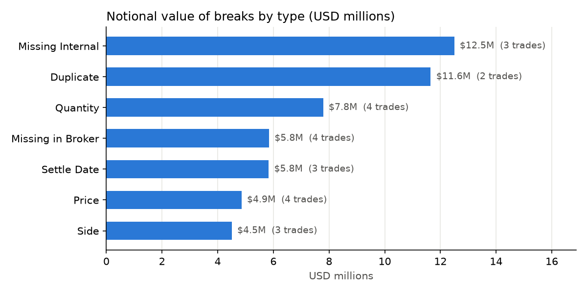

# Trade Reconciliation Tool

**An automated control that compares internal trade records with a broker statement, finds every mismatch, and tells the operations team what to fix first.**

Built in Python (pandas) as Project 1 of *The Analyst Engineer Series*: four projects at the intersection of finance and automation.



---

## The problem

Every trade a firm books exists in at least two places: its own records and its counterparty's. When the two disagree and nobody notices:

- trades **fail to settle**, or settle twice
- **positions and P&L are wrong**, so risk reports are wrong
- **auditors and regulators** flag the firm for inaccurate books

Reconciliation is the daily control that catches these "breaks". In many firms it is still done partly by hand in Excel: two sheets, lookups and visual checks. That is slow, hard to scale, and easy to get wrong.

## What the tool does

Two CSV files go in. A prioritised Excel report and a chart come out, in seconds.

| Step | Question it answers | How |
|---|---|---|
| 1. Load | What do I have? | Reads both files |
| 2. Standardise | Can I compare like with like? | Maps each source's column names, date formats and buy/sell codes to one layout |
| 3. Compare | Where do they disagree? | Matches trades on ID (with a fallback on trade details), then checks each field. Price allows a small rounding tolerance; quantity, side and dates must match exactly |
| 4. Classify | What kind of problem is each one? | Labels every trade: Matched, Price, Quantity, Side, Settle Date, Missing in Broker, Missing Internal or Duplicate |
| 5. Prioritise | What matters most? | Values each break in USD notional |
| 6. Report | Who needs to know what? | Excel file with three tabs: **Summary** for managers, **Breaks** for the ops team, **Matched** as the audit trail |

## Results

Test run: 200 internal trades against a broker statement containing 26 planted scenarios.

| Measure | Result |
|---|---|
| Trades checked | 205 |
| Matched | 182 (88.8%) |
| Breaks found | 23 |
| Notional at risk | **$52,964,768** |
| Planted breaks caught | **23 of 23**, all correctly labelled |
| Rounding differences correctly matched | 3 of 3 |

| Break type | Trades | Notional (USD) |
|---|---|---|
| Missing Internal | 3 | 12,495,820 |
| Duplicate | 2 | 11,649,880 |
| Quantity | 4 | 7,788,487 |
| Missing in Broker | 4 | 5,843,587 |
| Settle Date | 3 | 5,829,153 |
| Price | 4 | 4,853,956 |
| Side | 3 | 4,503,885 |

**Reading the result:** only 23 trades broke, but they carry $53M of notional. The 3 trades the broker holds that are missing from internal records ($12.5M) are the first to investigate.

## How it was validated

- **Answer key:** the sample data was generated with known, planted breaks. The tool's output is checked against that key automatically.
- **Tolerance test:** three trades have tiny price differences inside tolerance. All three correctly come out as Matched, so rounding does not create false alarms.
- **Sanity test:** reconciling a file against itself returns zero breaks.

## Sample data

The data is synthetic, because real trade data is confidential. It covers EURUSD, GBPUSD and XAUUSD trades from October 2026. The broker file is deliberately messy (different column names, dd/mm/yyyy dates, lowercase symbols with stray spaces, B/S codes, shuffled rows) to reflect real-world files.

## How to run it

1. Install the libraries:
   ```
   pip install -r requirements.txt
   ```
2. Open `recon_tool.ipynb` in Jupyter.
3. In the **Run it** cell, set the paths to your two CSV files.
4. Run all cells. The report and chart are saved to the `Output` folder.

To add a new broker, copy `BROKER_CONFIG` in the Settings cell and change its column names, date format and buy/sell codes. Nothing else needs editing.

## Project structure

```
├── recon_tool.ipynb        The tool: settings, functions, run, tests
├── Raw Data/
│   ├── internal_blotter.csv
│   ├── broker_statement.csv
│   └── answer_key.csv      Planted breaks, used for testing
├── Output/
│   ├── recon_report_<date>.xlsx
│   └── breaks_by_type.png
├── requirements.txt
└── README.md
```

## Next steps

- A web app (Streamlit): upload two files, click Run, download the report.
- Ageing of breaks: how many days each break has been open.
- Support for more asset classes and multiple brokers in one run.

## Author

**Kwanele Cakata**: financial markets professional (FX and commodities) building practical tools for finance operations and analysis.
